 
<div align="center">


<a href="https://git.io/typing-svg">

</a>

<br/>

<a href="https://github.com/LucasBlackS2">

</a>
<a href="https://github.com/LucasBlackS2?tab=repositories">

</a>


</div>

---

## 🧠 Sobre mim

```java
public class JoseLucas {

    String role = "Full Stack Developer";
    String mindset = "Aprender • Construir • Evoluir";

    String[] backend = {
        "Java", "Spring Boot", "REST APIs"
    };

    String[] frontend = {
        "React", "React Native", "TypeScript"
    };

    String[] databases = {
        "MySQL", "SQL"
    };

    String[] interests = {
        "Inteligência Artificial",
        "Cloud Computing",
        "Arquitetura de Software",
        "Desenvolvimento Mobile"
    };
}
```

🚀 Desenvolvedor em formação, apaixonado por tecnologia, programação e inovação.

🎯 Meu objetivo é transformar ideias em aplicações funcionais, modernas e escaláveis, sempre buscando aprender novas tecnologias e aprimorar minhas habilidades.

---

## ⚡ Tech Stack

<div align="center">

**Backend**


**Frontend & Mobile**


**Banco de Dados**


**Ferramentas**


</div>

---

## 🚀 Projetos em destaque

<div align="center">

<a href="https://github.com/LucasBlackS2/Sitara">

</a>

<a href="https://github.com/LucasBlackS2/Appdelogistica">

</a>

<a href="https://github.com/LucasBlackS2/animes-brasil-nextjs">

</a>

<a href="https://github.com/LucasBlackS2/aulaSpringBootWeb">

</a>

</div>

| Projeto | Descrição | Tecnologias |
|---|---|---|
| 🤖 [Sitara](https://github.com/LucasBlackS2/Sitara) | Tecnologia, interação e inteligência artificial | TypeScript, React, AI |
| 🚚 [App de Logística](https://github.com/LucasBlackS2/Appdelogistica) | Gerenciamento de processos logísticos | TypeScript, React, APIs |
| 🎌 [Animes Brasil](https://github.com/LucasBlackS2/animes-brasil-nextjs) | Plataforma web sobre animes | JavaScript, Next.js |
| ☕ [Spring Boot Web](https://github.com/LucasBlackS2/aulaSpringBootWeb) | Desenvolvimento de aplicações Java | Java, Spring Boot |

---


## 📊 GitHub Analytics

<div align="center">


<br/><br/>


</div>


---

## 👾 Pac-Man comendo meus commits

<div align="center">



</div>

---

## 🎯 Atualmente estudando

```text
Java / Spring Boot       ████████████████░░░░  80%
React / React Native     ███████████████░░░░░  75%
APIs REST                ███████████████░░░░░  75%
TypeScript               ██████████████░░░░░░  70%
MySQL / SQL              █████████████░░░░░░░  65%
Inteligência Artificial  ███████████░░░░░░░░░  55%
Cloud Computing          ██████████░░░░░░░░░░  50
